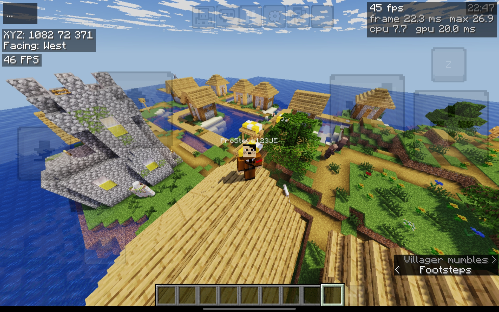
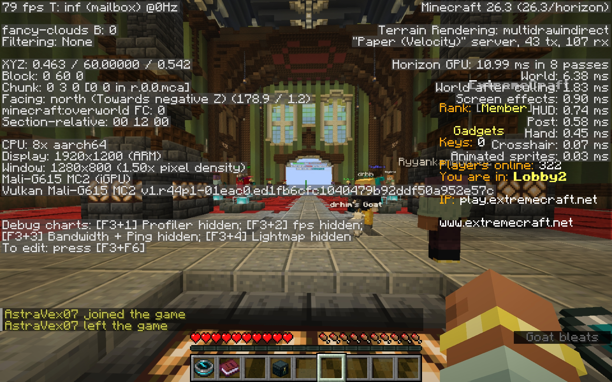
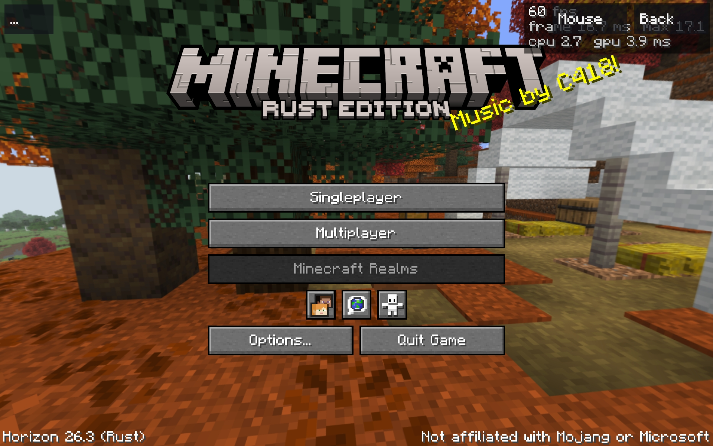

# Horizon Android

**An unofficial native Android port of [Horizon](https://github.com/horizon-rust/horizon), the Rust reimplementation of Minecraft: Java Edition 26.3.**

Horizon Android brings the Horizon game engine to Android with a native Rust/wgpu game runtime and a Jetpack Compose launcher. It supports touch-first play, single-player worlds and Java multiplayer without requiring a Java runtime on the device.

> **Development status:** This fork is actively changing. Builds linked below are experimental development builds, not stable releases. Device, graphics-driver, account and server compatibility can vary.

[Get the latest dev APK](https://github.com/ProSteve123GH/horizon-android-old/releases/tag/dev-latest) · [Android guide](docs/android.md) · [Feature support](docs/android-features.md) · [Contributing](CONTRIBUTING_ANDROID.md) · [Report an issue](https://github.com/ProSteve123GH/horizon-android-old/issues)

## Screenshots

| Village and touch controls | Main menu |
| --- | --- |
|  |  |

Device capture of a Java multiplayer lobby, with the debug overlay left visible:



*FPS readings and frame times in these captures are observations on the photographed devices, not controlled benchmarks.*

## Features

- **Native Android game client.** Rust game runtime using wgpu, with Vulkan rendering paths and experimental OpenGL ES support.
- **Four touch-control schemes.** Joystick or D-pad movement, each with tap-to-interact or crosshair aiming. Customize button positions, sizes, opacity, handedness and layout profiles.
- **A dedicated Android launcher.** Jetpack Compose interface for installation, world and instance management, saved servers, skins, packs, shaders, mods, settings and diagnostics.
- **Minecraft installation and repair.** Download Minecraft Java 26.3 directly on the device, or import an existing 26.3 installation from a folder or ZIP. Downloads are verified against pinned hashes and can be reused after interruption.
- **Worlds and instances.** Manage separate instances and their worlds, settings, mods, resource packs and shader packs. Browse, rename, duplicate, launch and delete worlds.
- **Graphics and performance controls.** Rendering-mode selection, resolution scaling, frame limits, per-instance performance presets, optional display-refresh requests and Android performance hints on supported devices.
- **Input and accessibility.** Touch, physical keyboard and mouse input, configurable keypad controls, orientation options, HUD margins and gyroscope aiming where available.
- **Sound and device integration.** AAudio playback, Android vibration, screenshots with a gallery, and Android Keystore-backed storage for saved account credentials.
- **Horizon content mods.** Sandboxed `.hmod` content support on 64-bit builds. Resource packs and shader packs can also be installed through the launcher.

See [Android feature support](docs/android-features.md) for the detailed implementation and remaining platform work.

## Compatibility and limitations

Horizon Android currently targets **Minecraft: Java Edition 26.3**. It does not run arbitrary Minecraft JAR versions.

| APK ABI | Minimum Android version | Notes |
| --- | --- | --- |
| `arm64-v8a` | Android 9 / API 28 | Primary Android target |
| `x86_64` | Android 9 / API 28 | Supported build target |
| `armeabi-v7a` | Android 8.1 / API 27 | Experimental legacy build; no Wasmtime `.hmod` runtime |
| `x86` | Android 8.1 / API 27 | Experimental legacy build; no Wasmtime `.hmod` runtime |

A supported CPU architecture does not guarantee that a device's GPU driver, memory capacity or Android firmware will work well. Rendering and performance need to be evaluated on the actual device.

Important limitations:

- **Java mods do not run.** Fabric, Forge, NeoForge and Mixin Java code require a Java runtime and loader that this native client does not provide.
- **Native-code mods are not built for Android.** The sandboxed content portion of compatible `.hmod` packages is supported on 64-bit builds; native source builds and legacy `.hnmod` execution are not supported by the Android build pipeline.
- **Hardware gamepad support is incomplete.** Keyboard and mouse paths are available, and keypad/D-pad navigation is supported, but a complete analog gamepad backend is still unfinished. Android TV support is experimental.
- **Account integration is still a development configuration.** The current Microsoft sign-in registration is temporary; production registration and full end-to-end account validation remain outstanding. Server and anticheat compatibility should be tested with the specific server.
- **A successful build is not a device test.** CI compilation and source tests do not establish gameplay stability, graphics compatibility, thermals or performance on every Android device.

## Install a development build

The fork currently publishes a rolling **`dev-latest`** development APK. The release page is updated by the build workflow; its assets may be replaced by a newer build.

1. Open [Horizon Android Dev releases](https://github.com/ProSteve123GH/horizon-android-old/releases/tag/dev-latest).
2. Download `Horizon-Android-dev-arm64-v8a.apk` for a typical 64-bit ARM Android device. Other ABI builds can be selected from a workflow run when available.
3. Verify the APK with the accompanying `SHA256SUMS.txt` file.
4. Install the APK. Android may ask you to allow installation from the browser or file manager you used.
5. Launch Horizon and choose **Download Minecraft 26.3**, or use **Import folder** / **Import ZIP** to reuse your own local 26.3 files.
6. Wait for resource verification and installation, then start a world or connect to a server.

The first setup downloads approximately **500 MiB**, including sounds. Files are retrieved from official Mojang HTTPS endpoints and checked against pinned hashes. Once installed, the verified resources can be used offline. Use a Minecraft account that owns Java Edition for authenticated multiplayer; account sign-in in this fork is still subject to the development-configuration limitation above.

For additional ABIs, open the [Android dev-build workflow](https://github.com/ProSteve123GH/horizon-android-old/actions/workflows/android-dev.yml). A manual workflow run can request all four ABI builds. Read [Development APKs](docs/android-dev-builds.md) before installing or distributing these builds.

## Build from source

The Android build uses the Rust toolchain pinned in `rust-toolchain.toml`, Python 3.11+, Android SDK platform 36, Android build tools 35, NDK 28.2.13676358, JDK 17 for Gradle and Gradle 8.14. JDK 25 is used only for the Minecraft 26.3 data exporters; the game itself is native Rust and does not run the Java client.

Prepare the private engine inputs and build an APK for the requested ABI:

```sh
rustup target add aarch64-linux-android armv7-linux-androideabi i686-linux-android x86_64-linux-android
python tools/android_prepare.py
python tools/android_build.py --abi arm64-v8a --public
```

Other ABI values are `armeabi-v7a`, `x86` and `x86_64`. See the [Android build guide](docs/android.md#build-developers-only) for full setup, signing, output paths and checks. Keep generated inputs, Minecraft files, APKs, account data and signing keys out of Git.

## Development and contributions

This repository is an unofficial Android fork of [Vasysik/horizon-android](https://github.com/Vasysik/horizon-android), which packages the [Horizon Rust engine](https://github.com/horizon-rust/horizon). The fork preserves upstream authorship and history while maintaining Android-specific launcher, input, storage and platform integration.

Contributions are welcome. Useful areas include touch input, accessibility, Android lifecycle and save recovery, hardware controllers, graphics-driver compatibility, profiling and device testing. Please include the device model, Android version, ABI, renderer, resolution scale, render distance and APK/source version in reproducible reports. Do not attach account tokens, session files, signing keys or complete app data.

Start with:

- [Android contribution guide](CONTRIBUTING_ANDROID.md)
- [General contribution guide](CONTRIBUTING.md)
- [Android documentation index](docs/README.md)
- [Implementation progress](IMPLEMENTATION_PROGRESS.md)
- [Roadmap](ROADMAP.md)

## License and attribution

The project's original work is licensed under the [MIT License](LICENSE). Dependencies retain their own licenses; see [THIRD_PARTY_NOTICES.md](THIRD_PARTY_NOTICES.md). Minecraft game files and Mojang textures are not covered by Horizon's MIT license and are not bundled as game resources in public APKs. The app downloads required original resources from official sources.

**Horizon Android is not an official Minecraft product and is not approved by or associated with Mojang or Microsoft.** Minecraft is a trademark of Mojang Synergies AB.
